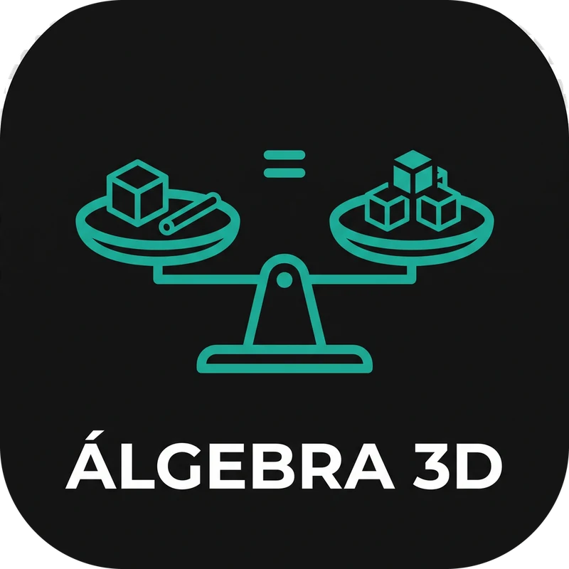

# Álgebra 3D

Math for students aged 8–16, in two modes:

- **🎮 Learn (ages 8–13)**: a gamified path of 36 levels in five tracks (add & subtract, multiply, divide, fractions & %, algebra). Pick your age and each track starts at the right level. See [Learning path](#learning-path).
- **🧮 3D solver (ages 13–16)**: type an equation and watch it solved step by step in a 3D scene:

- **Balance scale with algebra blocks** for linear equations (x³ cubes, x² flats, x rods, y rods, unit cubes; red = negative). Blocks drop in, cancel as zero pairs, and split into equal groups when dividing.
- **Area / volume models** for factoring: `x² + 5x + 6` assembles into an (x + 2)(x + 3) rectangle, and `x³ + 3x²` stacks into an x · x · (x + 3) box.
- **3D graphs** for functions (`y = x + 2` shows the table, intercept, and rise/run arrows), for roots of polynomials, circles (`x² + y² = 25`), and surfaces (`z = x² − y²`).
- **Game-style camera**: drag to orbit, WASD to walk, Q/E to turn, R/F for up/down, +/− to zoom. Each step flies the camera to a good view.
- **Step navigation**: ◀ ▶ buttons, ← → keys, Space to autoplay, End for the final view.
- **Systems of equations**: up to 10 equations in x and y separated by `;`, e.g. `x+2=y; 3x-2y=2`. Each equation is graphed, then solved step by step by substitution (two circles are subtracted first to get a line; curves with no algebraic route are solved numerically). The final view shows every graph and all intersections.
- **Examples sidebar**: the list scrolls forever and generates new practice formulas with clean answers. Click ☆ to pin a formula to the Favorites stack at the top (saved in localStorage). The ☆ next to the input pins your own formula.
- **Help guide**: the **? Ayuda / Help** button to the right of the language switch opens a guide covering typing rules, every problem type (with clickable examples), step and camera controls, colours, favorites, and troubleshooting.
- **Languages**: Spanish (Mexico) by default; the ES/EN switch in the header changes to English (US). The choice is remembered (`?lang=en` also works).
- **Mobile layout**: on screens up to 720px wide, expand buttons open the formula and examples, the 3D canvas, or the step card full screen, and a floating ✕ button at the bottom closes it. The formula badge over the canvas is hidden there, since the step card already shows it.
- **Sharing**: links (including `?q=` links) show a preview with `public/og-image.jpg`. See [Link previews](#link-previews).

## Learning path

The first screen asks for the child's age (8–13). Each age maps to a school grade (US grade = age − 5; Mexico 3º primaria to 2º secundaria) and starts every track at the level expected for that grade; earlier levels stay open as review.

| Age | Add / subtract | Multiply | Divide | Fractions & % | Algebra |
|---|---|---|---|---|---|
| 8 | to 100, to 1,000 | tables 2, 5, 10, then 3, 4 | sharing into 2, 5, 10 | naming slices | missing number `? + 7 = 12` |
| 9 | to 100,000 | all tables, 2 digits × 1 | facts, 2–3 digits ÷ 1, remainders | of a number, equivalent, same denominator | `x + 7 = 12` |
| 10 | decimals | 2 × 2 digits | ÷ 2 digits | unlike denominators, × fractions | order of operations |
| 11 | negative numbers | decimals × whole | decimals ÷ whole | percent | `3x = 12`, evaluate expressions |
| 12 | integers | signed products | – | ratios and proportions | `3x + 4 = 19` |
| 13 | – | – | – | – | `5x + 3 = 2x + 12`, `3(x + 2) = 15`, then the 3D solver |

Add `?test=true` to the URL to open every level (a purple TEST badge shows in the header).

Game rules: 10 questions per round, 5 hearts (a mistake costs one), 3 ★ for at most 1 mistake, 2 ★ for 2–3, 1 ★ for 4. A level opens when the one before has at least 1 ★. XP grows with answer streaks and star bonuses, ranks go from Apprentice to Legend, 10 badges, and a daily streak. A synthesized "ding" plays on correct answers (mute button in the header). Everything is saved in localStorage. Algebra questions have a **See it in 3D** button that opens the same equation in the solver. Questions are bilingual and each carries an explanation shown after a mistake.

The grade expectations come from the Common Core grade 3–8 standards (operations, fractions, ratios, expressions and equations) and the SEP primary and secondary programs, written from memory rather than checked against the documents.

## Stack

Astro 6 (Vite) + Preact island + Three.js + KaTeX. Node ≥ 22.12 (`.nvmrc` pins 24).

```sh
nvm use
npm install
npm run dev      # http://localhost:4321
npm test         # solver tests (vitest)
npm run build    # static site in dist/
```

## Deploy

The site is served from the [fanpage.me](https://github.com/acidkeyxyz/fanpage.me) repo at [acidkey.xyz/projects/algebra-3d/](https://acidkey.xyz/projects/algebra-3d/), which is why `astro.config.mjs` sets `base: '/projects/algebra-3d'`.

```sh
nvm use                # pnpm runs scripts with whatever `node` is on PATH; Astro needs ≥ 22.12
pnpm build
rsync -a --delete dist/ ../fanpage.me/projects/algebra-3d/
cd ../fanpage.me
git add projects/algebra-3d
git commit -m "chore(algebra-3d): deploy new build"
git push
```

nginx serves the fanpage.me folder as static files, so new builds show up right away. Restart it (`sudo systemctl reload nginx`) only after changing its config.

### Link previews

`src/pages/index.astro` sets Open Graph / Twitter tags with `public/og-image.jpg` (1200×630). Crawlers don't run JS, so every shared link gets the same preview, including links with `?q=`.

## Layout

- `src/lib/parser.ts` turns student input (`2x`, `3(x+1)`, `x²`, `−`) into an AST, then a polynomial or numeric function.
- `src/lib/solver.ts` builds the explained steps, each with a scene (balance, box, graph, surface). All text is bilingual via `T(en, es)`.
- `src/lib/view.ts` converts a scene into positioned 3D objects with stable keys, so blocks animate between steps.
- `src/three/Stage.ts` holds the Three.js renderer, animations, and camera controls.
- `src/components/` contains the Preact UI (`App`, `Viewer`, `LangSwitch`, KaTeX `Math`).
- `src/lib/i18n.ts` has the language state and UI strings.
- `src/lib/system.ts` handles systems of equations (substitution, circle subtraction, numeric fallback).
- `src/lib/learn.ts` has the levels, age map and question generators for Learn mode; `src/lib/progress.ts` has XP, ranks, stars and badges; `src/components/Learn.tsx` is the game UI.
- `src/lib/generate.ts` builds random formulas from their answers; `src/lib/favorites.ts` stores starred formulas.

## Contributing

Contributions are welcome. Open an issue or a pull request.

## License

Copyright (C) 2026 Luis Mendoza

This program is free software: you can redistribute it and/or modify it under the terms of the GNU General Public License as published by the Free Software Foundation, either version 3 of the License, or (at your option) any later version. See [LICENSE](LICENSE) for the full text.
